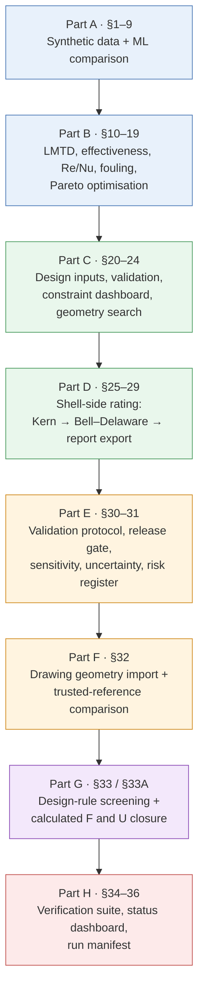
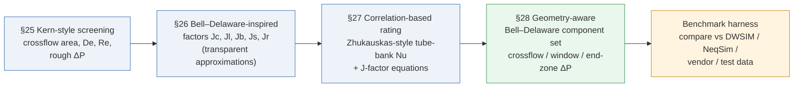
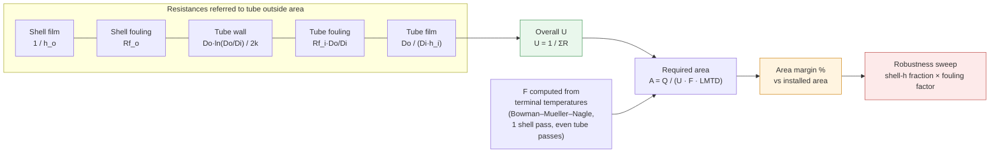
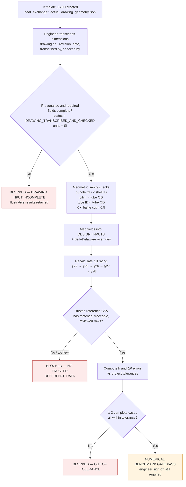
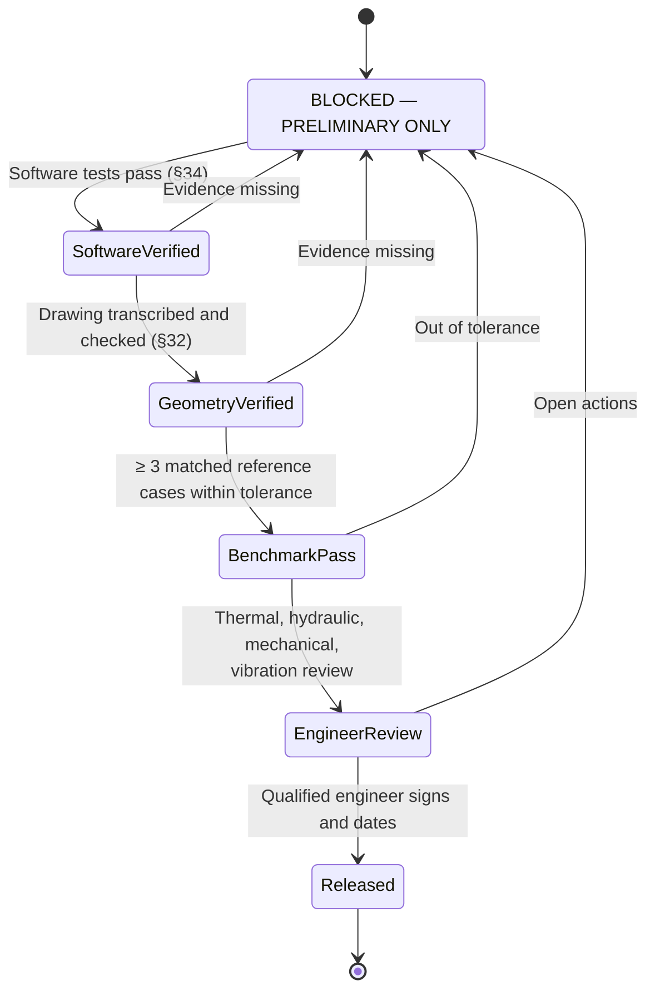
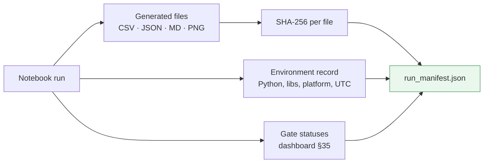

# Shell-and-Tube Heat Exchanger — Screening, Drawing-Geometry Import & Trusted-Reference Validation


An engineering calculation notebook for **preliminary thermal-hydraulic screening** of shell-and-tube heat exchangers, with a **gated workflow** for importing real drawing geometry and comparing results against independent, traceable reference ratings.

> ⚠️ **Intended use.** Preliminary screening and a validation workflow only. This is **not** a validated design tool and **not** for fabrication, procurement or performance guarantees. Final design requires independent benchmark evidence and sign-off by a qualified heat-exchanger engineer.

Notebook: `Heat_Exchanger_Drawing_Geometry_Trusted_Reference_Validation_upgraded.ipynb`

---

## Table of Contents

1. [What this project does](#what-this-project-does)
2. [Notebook architecture](#notebook-architecture)
3. [Notebook contents (Parts A–H)](#notebook-contents-parts-ah)
4. [Heat exchanger schematic](#heat-exchanger-schematic)
5. [Shell-side modelling ladder](#shell-side-modelling-ladder)
6. [Rating closure: computed F and U](#rating-closure-computed-f-and-u)
7. [Drawing import and reference validation flow](#drawing-import-and-reference-validation-flow)
8. [Release gate logic](#release-gate-logic)
9. [Key equations](#key-equations)
10. [Quick start](#quick-start)
11. [Inputs](#inputs)
12. [Generated output files](#generated-output-files)
13. [Software verification and audit trail](#software-verification-and-audit-trail)
14. [Limitations](#limitations)
15. [Revision history](#revision-history)
16. [References](#references)
17. [Author](#author)

---

## What this project does

| Capability | Where |
|---|---|
| Synthetic dataset + ML regression comparison (baseline, MLP, optional XGBoost) — *learning illustration only* | §1–9 |
| LMTD, effectiveness, NTU, illustrative pressure drop, interactive widgets | §10–14 |
| Reynolds / Prandtl / Nusselt (Dittus–Boelter), fouling-aware U, TEMA designation helper | §15–17 |
| Multi-objective search with a Pareto front (duty vs pressure drop vs pumping power) | §18 |
| Structured design inputs, validation, constraint dashboard, geometry search | §20–24 |
| Shell-side rating: Kern screening → Bell–Delaware-inspired → correlation-based → geometry-aware | §25–28 |
| Report export (JSON / CSV) | §29 |
| Independent validation protocol, release gate, risk register, sensitivity & uncertainty envelope | §30–31 |
| Drawing-geometry import with provenance checks and trusted-reference comparison | §32 |
| Design-rule screening against common heuristics | §33 |
| **Calculated** LMTD correction factor F and overall U, resistance breakdown, area-margin robustness sweep | §33A |
| Software verification suite, status dashboard, SHA-256 run manifest | §34–36 |

The notebook is deliberately honest about its limits: **passing software tests is not physical validation**, and the overall release status stays `BLOCKED — PRELIMINARY ONLY` until real benchmark evidence and a qualified engineer's sign-off are recorded.

---

## Notebook architecture



---

## Notebook contents (Parts A–H)

| Part | Sections | Description |
|---|---|---|
| A | 1–9 | Synthetic dataset and ML regression comparison (learning illustration only) |
| B | 10–19 | LMTD, effectiveness, optimisation, Re/Nu/fouling, multi-objective search |
| C | 20–24 | Design inputs, validation, constraint dashboard, sensitivity |
| D | 25–29 | Shell-side rating: Kern screening, Bell–Delaware, correlations, report export |
| E | 30–31 | Independent validation protocol, release gate, professional workflow pack |
| F | 32 | Drawing-geometry import and trusted-reference comparison |
| G | 33 | Design-rule and applicability screening against common heuristics |
| G+ | 33A | Calculated rating closure: computed F and U from film coefficients, resistance breakdown, area-margin robustness sweep |
| H | 34–36 | Software verification suite, status dashboard and run manifest (SHA-256 audit trail) |

---

## Heat exchanger schematic

Simplified view of the single-shell, two-tube-pass configuration used by the default example (`tube_passes = 2`, `shell_passes = 1`).

```
        Shell-side fluid IN
                │
                ▼
   ┌────────────────────────────────────────────────┐
   │  ┌──┐     ┌──┐     ┌──┐     ┌──┐     ┌──┐       │
   │  │B │     │B │     │B │     │B │     │B │  ← segmental baffles
   │  │  │     │  │     │  │     │  │     │  │       │
 ══╪══╪══╪═════╪══╪═════╪══╪═════╪══╪═════╪══╪═══►   │  Tube pass 1
   │  │  │     │  │     │  │     │  │     │  │       │
 ◄═╪══╪══╪═════╪══╪═════╪══╪═════╪══╪═════╪══╪═══    │  Tube pass 2
   │  └──┘     └──┘     └──┘     └──┘     └──┘       │
   └────────────────────────────────────────────────┘
                                │
                                ▼
                    Shell-side fluid OUT

 Tube-side fluid:  IN ══► pass 1 ══► return ══► pass 2 ══► OUT
```

Default illustrative geometry (from `DESIGN_INPUTS`): 80 tubes, 19 mm OD / 16 mm ID, 4 m long, 25.4 mm triangular pitch, 0.35 m shell ID, 0.15 m baffle spacing, 25 % baffle cut.

---

## Shell-side modelling ladder

The notebook builds up the shell-side model in four steps. Each step is kept in the report for comparison; none of them is independently validated.



**Bell–Delaware correction factors**

| Factor | Mechanism |
|---|---|
| `Jc` | Baffle cut / central crossflow fraction |
| `Jl` | Shell-to-baffle and tube-to-baffle leakage |
| `Jb` | Bundle bypass (reduced by sealing strips) |
| `Js` | Unequal inlet / outlet baffle spacing |
| `Jr` | Low-Reynolds-number correction |

Corrected shell-side coefficient: `h_shell = h_ideal × Jc × Jl × Jb × Js × Jr`

---

## Rating closure: computed F and U

Section 33A replaces the earlier *assumed* values (`U_clean = 900 W/m²K`, `F = 0.90`) with **computed** ones.



The tube-side `h` comes from Dittus–Boelter (with a Gnielinski fallback for transitional flow); the shell-side `h` comes from the geometry-aware Bell–Delaware screen (§28) and inherits all of its estimate flags. The robustness sweep (`area_margin_robustness.png`) shows how far the shell-side `h` can be over-estimated, and how much the fouling can grow, before the area margin disappears.

---

## Drawing import and reference validation flow

The notebook **does not read CAD drawings automatically**. Dimensions must be transcribed from an approved drawing and independently checked.



A reference row counts as **evidence** only if all of these hold: geometry, fluid properties, operating point and nozzle-loss treatment are matched; source, version/date and report ID are recorded; reviewer name, qualification and date are filled in; and tolerances were agreed up front.

---

## Release gate logic



The three independent gates are **software verification**, **thermal-hydraulic validation** and **engineering approval**. The notebook ships with only the first one achievable on its own; the other two need real-world evidence.

---

## Key equations

**Heat duty and LMTD (counter-current)**

$$Q = \dot m\, c_p\, \Delta T \qquad
\Delta T_{lm} = \frac{\Delta T_1 - \Delta T_2}{\ln(\Delta T_1 / \Delta T_2)} \qquad
Q = U\,A\,F\,\Delta T_{lm}$$

**Effectiveness–NTU (counter-flow)**

$$\varepsilon = \frac{1 - e^{-NTU(1-C_r)}}{1 - C_r\, e^{-NTU(1-C_r)}} \qquad NTU = \frac{UA}{C_{min}}$$

**Tube-side film coefficient (Dittus–Boelter, Re ≥ 10,000)**

$$Nu = 0.023\, Re^{0.8}\, Pr^{n} \qquad h_i = \frac{Nu\,k}{D_i}$$

**Shell-side ideal tube-bank Nusselt number (Zhukauskas-style)**

$$\text{Triangular: } Nu = 0.35\left(\frac{P_t}{D_o}\right)^{0.2} Re^{0.6} Pr^{0.36}\left(\frac{Pr}{Pr_w}\right)^{0.25}$$

$$\text{Square: } Nu = 0.27\, Re^{0.63} Pr^{0.36}\left(\frac{Pr}{Pr_w}\right)^{0.25}$$

**Shell-side pressure-drop components (Bell–Delaware structure)**

$$\Delta P_{id} = \frac{2 f_i N_{cl} G_s^2}{\rho_s} \qquad
\Delta P_{cross} = (N_b - 1)\,\Delta P_{id}\,R_l R_b$$

$$\Delta P_{window} = \frac{N_b (2 + 0.6 N_{tw})\, G_w^2}{2\rho_s}\, R_l \qquad
\Delta P_{end} = 2\,\Delta P_{id}\left(1 + \frac{N_{cw}}{N_{cl}}\right) R_b$$

**Pumping power**

$$P_{pump} = \frac{\Delta P \cdot \dot V}{\eta_{pump}}$$

---

## Quick start

```bash
# 1. Clone the repository
git clone https://github.com/<your-username>/<your-repo>.git
cd <your-repo>

# 2. Create an environment (recommended)
python -m venv .venv
source .venv/bin/activate        # Windows: .venv\Scripts\activate

# 3. Install dependencies
pip install numpy pandas matplotlib scikit-learn jupyterlab ipywidgets
pip install xgboost              # optional — enables the XGBoost model in Part A

# 4. Launch and run top to bottom
jupyter lab Heat_Exchanger_Drawing_Geometry_Trusted_Reference_Validation_upgraded.ipynb
```

**Notes**

- Run the notebook **top to bottom** (`Kernel → Restart & Run All`). Stored outputs are cleared, so every result comes from a fresh run.
- `ipywidgets` is optional. Without it, the interactive calculator and TEMA selector are skipped, and the underlying functions can still be called directly.
- `xgboost` is optional. Without it, Part A uses only the baseline and MLP models.
- A fixed random seed (`42`) is used, and the environment (Python, library versions, platform, UTC time) is recorded in §1.1.

---

## Inputs

All inputs use **SI units** (m, kg/s, °C/K, W/m²K, kPa); heat duty is in kW.

| Group | Key fields in `DESIGN_INPUTS` |
|---|---|
| Process | `hot_inlet_C`, `hot_outlet_target_C`, `cold_inlet_C`, `cold_outlet_target_C`, mass flows, `cp` values |
| Tube-side fluid | `tube_side` (`"hot"`/`"cold"`), density, viscosity, `cp`, conductivity |
| Tube geometry | ID, OD, length, count, passes, pitch, layout (`triangular`/`square`) |
| Shell geometry | shell ID, baffle spacing, baffle cut, shell passes |
| Leakage / bypass | shell–bundle clearance, tube–baffle hole clearance, sealing-strip pairs, inlet/outlet baffle spacing |
| Resistances | `U_clean_W_m2K`, tube/shell fouling, wall resistance, `lmtd_correction_factor_F` |
| Limits | allowable tube/shell ΔP, pump efficiency, `minimum_thermal_margin_fraction` |

**To use real geometry**, edit `heat_exchanger_actual_drawing_geometry.json` (created by §32.1), fill every required field from the approved drawing, record the drawing number, revision and reviewers, and set `geometry_source_status` to `DRAWING_TRANSCRIBED_AND_CHECKED`. Use `null` for unknowns, and never substitute an unlabeled guess.

**To use a reference rating**, add one row per matched operating point to `trusted_reference_rating_comparison.csv`. Do not fabricate reference numbers.

---

## Generated output files

| Category | Files |
|---|---|
| ML (Part A) | `heat_exchanger_simulated_data.csv`, `model_comparison_metrics.csv`, `test_set_predictions.csv`, `actual_vs_predicted.png` |
| Optimisation | `heat_exchanger_optimization_results.csv`, `heat_exchanger_optimization_top10.csv`, `heat_exchanger_multi_objective_results.csv`, `heat_exchanger_pareto_front.csv` |
| Design report | `shell_tube_preliminary_design_report.json`, `shell_tube_preliminary_design_summary.csv`, `shell_tube_geometry_candidates.csv`, `shell_side_kern_screening.json`, `shell_side_bell_delaware_inspired_screening.json` |
| Validation templates | `independent_validation_benchmark_template.csv`, `engineering_review_signoff_template.json`, `engineering_release_status.json` |
| Professional pack | `heat_exchanger_professional_summary.json`, `heat_exchanger_professional_release_gate.json`, `heat_exchanger_professional_review.md`, `heat_exchanger_design_risk_register.csv` |
| Sensitivity / uncertainty | `heat_exchanger_sensitivity_screening.csv`, `heat_exchanger_uncertainty_scenarios.csv`, `heat_exchanger_uncertainty_summary.csv` |
| Drawing / reference | `heat_exchanger_actual_drawing_geometry.json`, `trusted_reference_rating_comparison.csv` |
| Screening / closure | `heat_exchanger_design_rule_screening.csv`, `rating_closure_report.json`, `area_margin_robustness.png` |
| Audit | `heat_exchanger_status_dashboard.csv`, `run_manifest.json` |

---

## Software verification and audit trail

- **§34 Software verification suite** — hand-calculation checks (LMTD, effectiveness, Re, Pr, Dittus–Boelter, fouling-free U), input-guard tests, energy-balance checks, ML-beats-baseline check, and logic tests for the drawing and reference gates. Tests that exercise the gates use synthetic rows and are **never** treated as evidence.
- **§35 Status dashboard** — one table summarising every gate, ending in the overall release status.
- **§36 Run manifest** — lists every generated/input `.csv`, `.json`, `.md` and `.png` file with size and **SHA-256** hash, together with the environment record and gate statuses, so a specific run can be identified and later verified as unmodified.



---

## Limitations

- **Not validated.** No external benchmark data or signed engineering review has been supplied. Software tests are not physical validation.
- **Part A is illustrative.** The ML models learn from synthetic data. The MLP is a standard supervised network, **not** a physics-informed neural network (PINN).
- **Constant fluid properties** and a simplified fouling treatment are used.
- **Dittus–Boelter** is a screening correlation for suitable turbulent flow only; it is not suitable for laminar, transitional, developing, very viscous or non-Newtonian flow.
- **Bell–Delaware is approximated.** Tube-row counts, window free area and the ideal-bank friction factor are estimated or placeholders unless overridden from the drawing or a trusted rating package. The leakage and bypass areas use simplified proxies.
- **F closure** is implemented only for one shell pass and an even number of tube passes.
- **Not assessed:** TEMA compliance, ASME Section VIII pressure-boundary and tubesheet design, tube vibration, nozzle and impingement checks, thermal expansion, gaskets and bolting, materials, two-phase boiling/condensation.
- Design-rule screening (§33) uses **rules of thumb**, not code requirements; `REVIEW` means "an engineer should look at this", not "non-compliant".

---

## Revision history

| Rev | Change |
|---|---|
| A | Initial notebook |
| B | Fixed MLP target scaling (R² ≈ 0 → ≈ 0.999); turbulent-flow example inputs; stricter drawing-geometry validation; added cover, environment record, verification suite and status dashboard |
| C | Flow-regime label now consistent with the Re ≥ 10,000 Dittus–Boelter limit; added design-rule screening (§33), run manifest (§36); stored outputs cleared so every result comes from a fresh run |
| D | Added §33A: LMTD correction factor F computed (not assumed), U built from tube/shell films + fouling + wall, Gnielinski fallback for transitional tube flow, controlling-resistance table, area-margin robustness sweep, 14 new software tests, dashboard row |

---

## References

- TEMA standards — https://tema.org/standards/
- ASME BPVC Section VIII (pressure vessels) — https://www.asme.org/codes-standards/find-codes-standards/bpvc-section-viii-rules-construction-pressure-vessels
- NeqSim `BellDelawareMethod` API — https://equinor.github.io/neqsimhome/javadoc/site/apidocs/neqsim/process/mechanicaldesign/heatexchanger/BellDelawareMethod.html
- DWSIM Advanced Heat Exchanger documentation — https://dwsim.org/help/main/24-unit-operations.html
- K. J. Bell (1981), *Delaware Method for Shell-Side Design*, in *Heat Exchangers: Thermal-Hydraulic Fundamentals and Design*
- Gonçalves et al., *Linear Method for the Design and Optimization of Shell-and-Tube Heat Exchangers Using the Bell–Delaware Method*, AIChE Journal

---

## Author

**Harpreet Singh** — GitHub: [@harpreetsingh171190-cmyk](https://github.com/harpreetsingh171190-cmyk)

## Disclaimer

This notebook is provided for education and preliminary screening. Results must not be used for fabrication, purchasing, safety cases or performance guarantees without independent validation and review by a qualified engineer.
